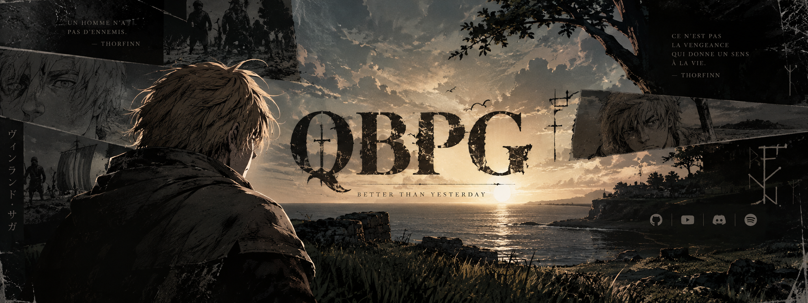

<h1>
𝒒𝒃𝒑𝒈
</h1>

I build web applications and browser extensions, with a focus on simplicity and interface design.

[Technologies](#technologies) · [Contact](#contact)

<!-- Keep username=qbpg: this is the existing cumulative counter. Do not replace it with a new counter ID. -->

<h2 align="center" id="technologies">Technologies</h2>

<h3>Languages</h3>

  
  
  
  

<h3>Frontend</h3>

  
  
  

<h3>Backend & databases</h3>

  
  

<strong>Deployment & tools</strong>

 

  
  

<h2 align="center" id="contact">Contact</h2>

  

 

*« I have no enemies. » — Thorfinn, Vinland Saga*

